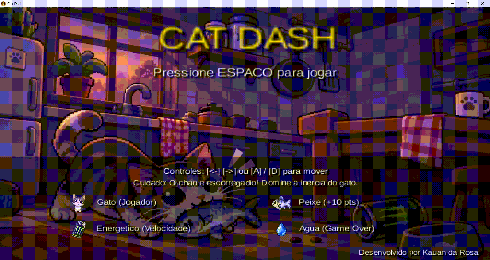

# Cat Dash 



Um jogo arcade 2D de ritmo acelerado desenvolvido como projeto acadêmico, focando em desvio de obstáculos, física espacial e reflexos rápidos.

## Tecnologias Utilizadas

* **Linguagem:** Java
* **Framework:** libGDX (Desenvolvimento de jogos multiplataforma)
* **Conceitos Aplicados:** Programação Orientada a Objetos (POO), Game Loop, Detecção de Colisão 2D, Gerenciamento de Estado.

## Como rodar o projeto localmente

Como este é um projeto Java utilizando Gradle, você pode rodá-lo facilmente se tiver a JDK instalada:

1. Clone o repositório:
   ```bash
git clone https://github.com/wxpett/cat-dash
